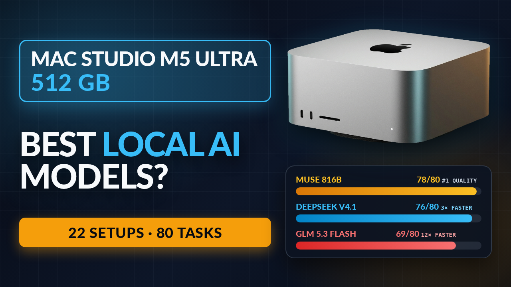
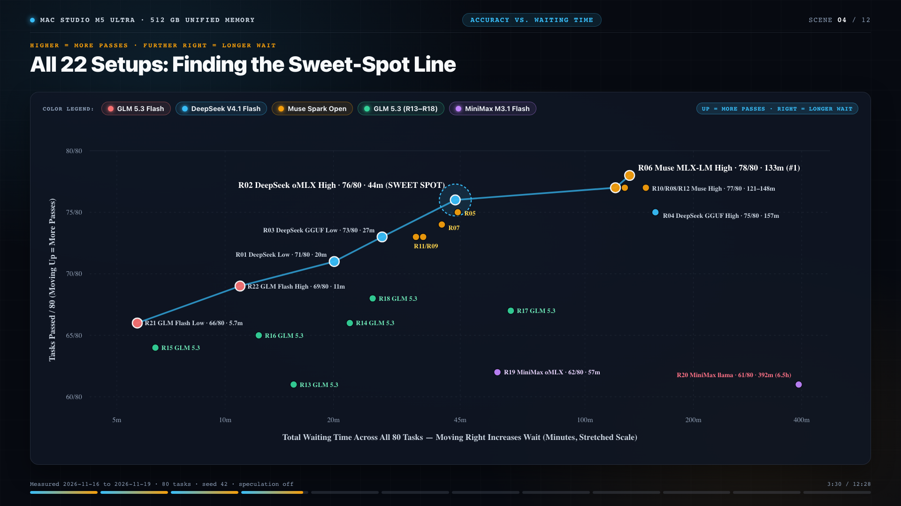
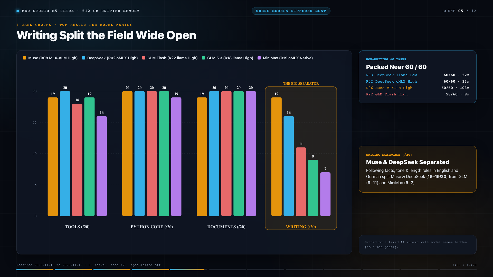
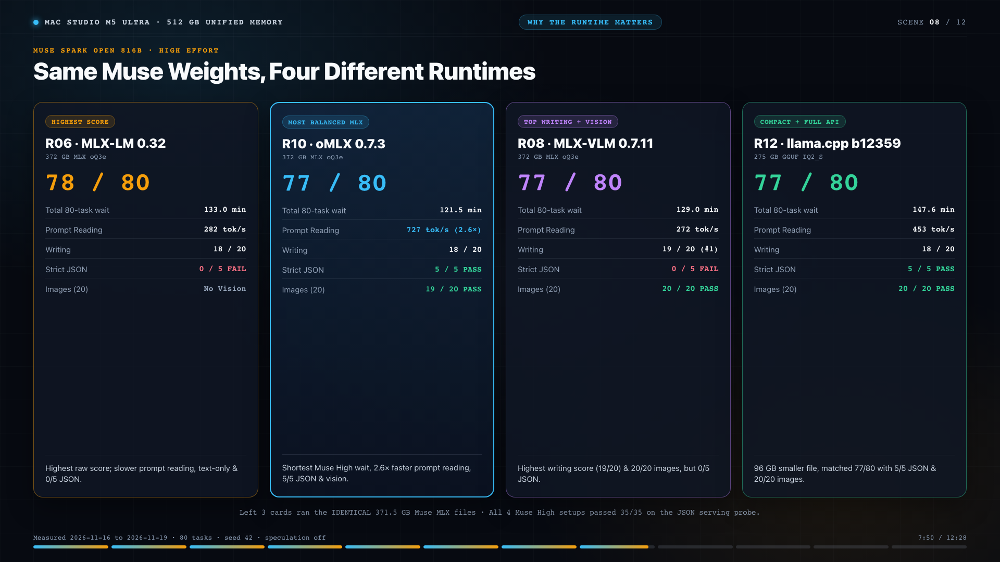

# 001 - 512GB Mac Studio M5 Ultra: 22-Setup Local AI Test Run

Companion dataset and recipe index for Episode 001 on [`l8w8` (@l8w8ai)](https://www.youtube.com/@l8w8ai): **[Watch the video on YouTube](https://youtu.be/vF-LUF6kPsE)**.

## Key Charts

| Accuracy vs. Waiting Time | Writing Split the Field Wide Open |
|---|---|
|  |  |

## Test Scope & Environment

- **Hardware:** Apple Mac Studio M5 Ultra (512 GB unified memory · up to 448 GiB active model budget)
- **OS:** macOS 26.4.1
- **Pinned measurement window:** `2026-11-16` to `2026-11-19` (seed `42`, speculative decoding / MTP **OFF** for all 80-task runs; MTP & newer engine updates are covered in Part 2)
- **Scope:** 5 model families (9 weight bundles, `248.8`–`432.0 GB`), 5 engines tested (4 working), **22 admitted setups (`R01`–`R22`)** + **15 unscored / incompatible setups**
- **Core benchmark:** 80 identical tasks (20 Tools, 20 sandboxed Python Code, 20 EN/DE Documents, 20 concealed-label Writing) = **1,760 per-task records**
- **Separate bounded probes:** Vision (20 images), Strict JSON Schema (5 contracts), Multi-Client Concurrency (35 requests across 1, 2 & 4 clients)

## Files in This Folder

- [`evidence/candidate-register.csv`](evidence/candidate-register.csv) - All 37 registered candidate setups (22 admitted `R01`–`R22` + 15 unscored with exact failure/exclusion stages, bundle sizes in decimal GB, and runtime versions).
- [`evidence/per-task.csv`](evidence/per-task.csv) - All 1,760 individual task outcomes (`pass`/`fail`), workflow API durations, wall times, request counts, and SHA-256 provenance hashes.
- [`facts.json`](facts.json) - Structured aggregate metrics used to generate every chart and table in the video.

## All 22 Admitted Setups (`R01`–`R22`)

Sorted by total passes out of 80 (then total API time ascending), matching Scene 3 of the video:

| ID | Model | Quant | Size (GB) | Runtime | Effort | Score (/80) | Total API Time | Tools | Code | Docs | Writing |
|---|---|---|---:|---|---|---:|---:|---:|---:|---:|---:|
| `R06` | Muse Spark Open 816B | `mixed oQ3e` | 371.5 | Bundled MLX-LM0.32.3.dev8+g0d4d3d04f | High | **78/80** (97.5%) | 133.0 min | 20/20 | 20/20 | 20/20 | 18/20 |
| `R10` | Muse Spark Open 816B | `mixed oQ3e` | 371.5 | oMLX0.7.3 | High | **77/80** (96.2%) | 121.5 min | 19/20 | 20/20 | 20/20 | 18/20 |
| `R08` | Muse Spark Open 816B | `mixed oQ3e` | 371.5 | MLX-VLM0.7.11 bundled / MLX0.32.4 | High | **77/80** (96.2%) | 129.0 min | 19/20 | 20/20 | 19/20 | 19/20 |
| `R12` | Muse Spark Open 816B | `UD-IQ2_S` | 275.5 | llama.cpp b12359 Metal | High | **77/80** (96.2%) | 147.6 min | 20/20 | 20/20 | 19/20 | 18/20 |
| `R02` | DeepSeek V4.1 Flash | `mixed oQ4e/Engram` | 432.0 | oMLX0.7.3 | High | **76/80** (95.0%) | 43.6 min | 20/20 | 20/20 | 20/20 | 16/20 |
| `R05` | Muse Spark Open 816B | `mixed oQ3e` | 371.5 | Bundled MLX-LM0.32.3.dev8+g0d4d3d04f | Low | **75/80** (93.8%) | 44.3 min | 19/20 | 20/20 | 19/20 | 17/20 |
| `R04` | DeepSeek V4.1 Flash | `UD-IQ2_XXS` | 300.5 | llama.cpp b12359 Metal | High | **75/80** (93.8%) | 156.9 min | 20/20 | 19/20 | 20/20 | 16/20 |
| `R07` | Muse Spark Open 816B | `mixed oQ3e` | 371.5 | MLX-VLM0.7.11 bundled / MLX0.32.4 | Low | **74/80** (92.5%) | 40.0 min | 19/20 | 20/20 | 20/20 | 15/20 |
| `R03` | DeepSeek V4.1 Flash | `UD-IQ2_XXS` | 300.5 | llama.cpp b12359 Metal | Low | **73/80** (91.2%) | 27.3 min | 20/20 | 20/20 | 20/20 | 13/20 |
| `R11` | Muse Spark Open 816B | `UD-IQ2_S` | 275.5 | llama.cpp b12359 Metal | Low | **73/80** (91.2%) | 33.9 min | 19/20 | 19/20 | 19/20 | 16/20 |
| `R09` | Muse Spark Open 816B | `mixed oQ3e` | 371.5 | oMLX0.7.3 | Low | **73/80** (91.2%) | 35.5 min | 19/20 | 20/20 | 19/20 | 15/20 |
| `R01` | DeepSeek V4.1 Flash | `mixed oQ4e/Engram` | 432.0 | oMLX0.7.3 | Low | **71/80** (88.8%) | 20.1 min | 19/20 | 19/20 | 20/20 | 13/20 |
| `R22` | GLM 5.3 Flash | `UD-Q6_K_XL` | 291.8 | llama.cpp b12359 Metal | High | **69/80** (86.2%) | 11.0 min | 18/20 | 20/20 | 20/20 | 11/20 |
| `R18` | GLM 5.3 | `UD-Q2_K_XL` | 253.9 | llama.cpp b12359 Metal | High | **68/80** (85.0%) | 25.7 min | 19/20 | 20/20 | 20/20 | 9/20 |
| `R17` | GLM 5.3 | `UD-Q2_K_XL` | 253.9 | llama.cpp b12359 Metal | Low | **67/80** (83.8%) | 62.2 min | 19/20 | 20/20 | 19/20 | 9/20 |
| `R21` | GLM 5.3 Flash | `UD-Q6_K_XL` | 291.8 | llama.cpp b12359 Metal | Low | **66/80** (82.5%) | 5.7 min | 17/20 | 19/20 | 19/20 | 11/20 |
| `R14` | GLM 5.3 | `affine4` | 418.3 | MLX-VLM0.7.11 bundled / MLX0.32.4 | High | **66/80** (82.5%) | 22.2 min | 18/20 | 20/20 | 19/20 | 9/20 |
| `R16` | GLM 5.3 | `affine4` | 418.3 | oMLX0.7.3 | High | **65/80** (81.2%) | 12.4 min | 18/20 | 18/20 | 20/20 | 9/20 |
| `R15` | GLM 5.3 | `affine4` | 418.3 | oMLX0.7.3 | Low | **64/80** (80.0%) | 6.4 min | 17/20 | 17/20 | 20/20 | 10/20 |
| `R19` | MiniMax M3.1 Flash | `mixed oQ4e` | 248.8 | oMLX0.7.3 | Native | **62/80** (77.5%) | 57.1 min | 16/20 | 19/20 | 20/20 | 7/20 |
| `R13` | GLM 5.3 | `affine4` | 418.3 | MLX-VLM0.7.11 bundled / MLX0.32.4 | Low | **61/80** (76.2%) | 15.5 min | 17/20 | 16/20 | 19/20 | 9/20 |
| `R20` | MiniMax M3.1 Flash | `UD-Q8_K_XL` | 259.1 | llama.cpp b12521 Metal, vendor-derived attention metadata correction | Native | **61/80** (76.2%) | 392.5 min | 17/20 | 18/20 | 20/20 | 6/20 |

## 15 Unscored / Incompatible Setups

Recorded in [`evidence/candidate-register.csv`](evidence/candidate-register.csv) so failures are transparent:

| Recipe | Checkpoint | Quant | Runtime | Effort | Stage |
|---|---|---|---|---|---|
| `deepseek-oq4-mlx-lm-low` | DeepSeek V4.1 Flash 1017 | `mixed oQ4e/Engram` | Bundled MLX-LM0.32.3.dev8+g0d4d3d04f | low | `unsupported-chat-protocol` |
| `deepseek-oq4-mlx-lm-high` | DeepSeek V4.1 Flash 1017 | `mixed oQ4e/Engram` | Bundled MLX-LM0.32.3.dev8+g0d4d3d04f | high | `unsupported-chat-protocol` |
| `glm-affine4-mlx-lm-low` | GLM 5.3 MLX | `affine4` | Bundled MLX-LM0.32.3.dev8+g0d4d3d04f | low | `unsupported-native-weight-layout` |
| `glm-affine4-mlx-lm-high` | GLM 5.3 MLX | `affine4` | Bundled MLX-LM0.32.3.dev8+g0d4d3d04f | high | `unsupported-native-weight-layout` |
| `minimax-oq4-mlx-lm-native` | MiniMax M3.1 Flash | `mixed oQ4e` | Bundled MLX-LM0.32.3.dev8+g0d4d3d04f | native | `unsupported-chat-protocol` |
| `minimax-ud-q8-k-xl-llama-native` | MiniMax-M3.1-Flash | `UD-Q8_K_XL` | llama.cpp b12359 Metal | native | `unsupported-native-runtime` |
| `minimax-oq4-mlx-vlm-native` | MiniMax M3.1 Flash | `mixed oQ4e` | MLX-VLM0.7.11 bundled / MLX0.32.4 | native | `unsupported-native-quantization-layout` |
| `deepseek-oq4-vllm-metal-low` | DeepSeek V4.1 Flash 1017 | `mixed oQ4e/Engram` | vLLM-Metal0.33.0 / vLLM0.33.0+cpu / MLX0.32.4 / isolatedCPython3.12.16 | low | `unsupported-native-runtime` |
| `deepseek-oq4-vllm-metal-high` | DeepSeek V4.1 Flash 1017 | `mixed oQ4e/Engram` | vLLM-Metal0.33.0 / vLLM0.33.0+cpu / MLX0.32.4 / isolatedCPython3.12.16 | high | `unsupported-native-runtime` |
| `glm-affine4-vllm-metal-low` | GLM 5.3 MLX | `affine4` | vLLM-Metal0.33.0 / vLLM0.33.0+cpu / MLX0.32.4 / isolatedCPython3.12.16 | low | `unsupported-native-runtime` |
| `glm-affine4-vllm-metal-high` | GLM 5.3 MLX | `affine4` | vLLM-Metal0.33.0 / vLLM0.33.0+cpu / MLX0.32.4 / isolatedCPython3.12.16 | high | `unsupported-native-runtime` |
| `minimax-oq4-vllm-metal-native` | MiniMax M3.1 Flash | `mixed oQ4e` | vLLM-Metal0.33.0 / vLLM0.33.0+cpu / MLX0.32.4 / isolatedCPython3.12.16 | native | `unsupported-native-runtime` |
| `muse-oq3-vllm-metal-low` | Muse Spark Open | `mixed oQ3e` | vLLM-Metal0.33.0 / vLLM0.33.0+cpu / MLX0.32.4 / isolatedCPython3.12.16 | low | `unsupported-native-runtime` |
| `muse-oq3-vllm-metal-high` | Muse Spark Open | `mixed oQ3e` | vLLM-Metal0.33.0 / vLLM0.33.0+cpu / MLX0.32.4 / isolatedCPython3.12.16 | high | `unsupported-native-runtime` |
| `minimax-ud-q8-k-xl-llama-b12521-native` | MiniMax-M3.1-Flash | `UD-Q8_K_XL` | llama.cpp b12521 Metal (official prerelease2026-11-18) | native | `unsupported-native-runtime` |

## Limitations & Notes

- **Personal test run:** Designed around real personal workflows; may contain errors, does not cover all workloads, and is not a universal ranking or disqualification of any model or runtime.
- **Writing scores:** Graded with a concealed-label AI rubric (model names hidden), not a human panel.
- **Small probes:** Vision (20 images) and strict JSON concurrency (35 requests) are bounded probes, not universal production capacity guarantees.
- **Video narration:** Synthesized locally on owned hardware from a clone of the creator's own voice.

## License

Data, CSVs, and documentation in this folder are licensed under [CC BY 4.0](../../LICENSE-DATA). Please credit `l8w8` and link back to this folder when reusing or charting these results.
