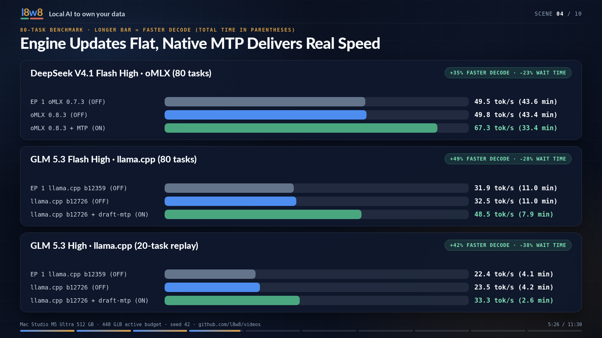
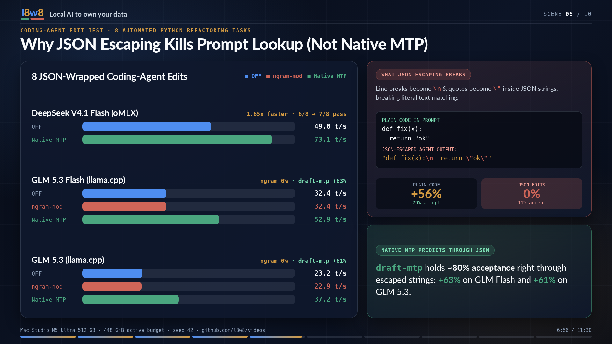
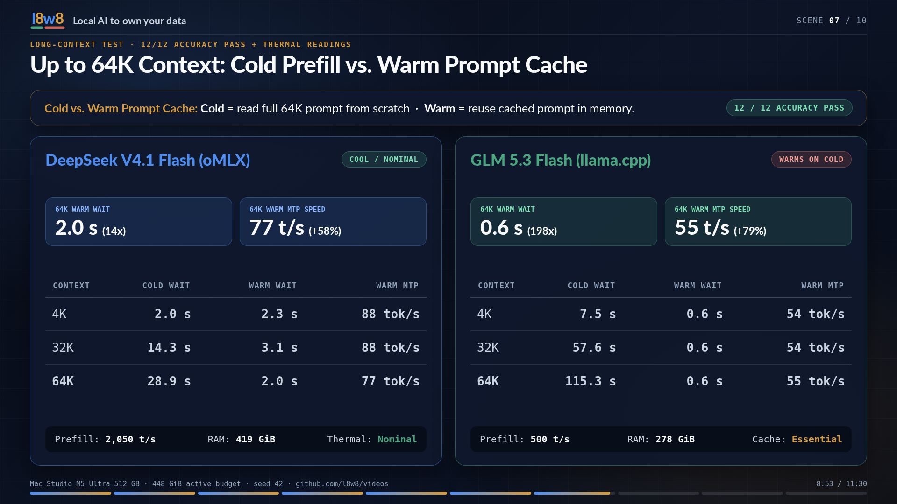
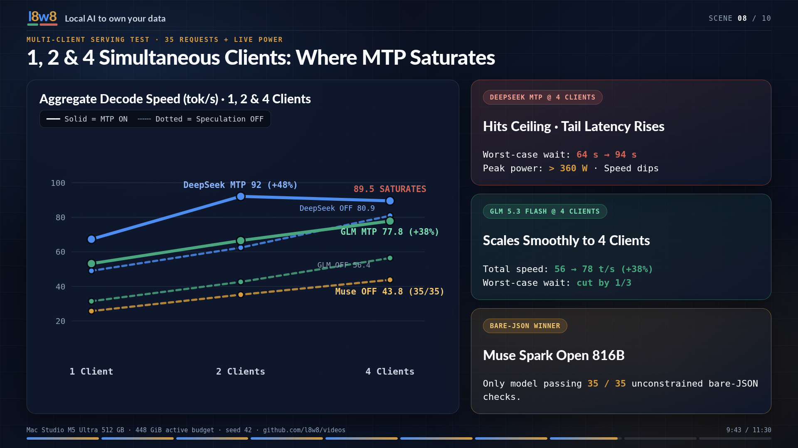

# 002 - Mac Studio M5 Ultra 512 GB Part 2: Speculative Decoding MTP On or Off?

Companion dataset and recipe index for Episode 002 on [`l8w8` (@l8w8ai)](https://www.youtube.com/@l8w8ai) *(YouTube video link will be added right after upload; Part 1 baseline: [`2026/001-m5-ultra-22-setup-comparison/`](../001-m5-ultra-22-setup-comparison/) | [Watch Part 1](https://youtu.be/vF-LUF6kPsE))*.

`l8w8 - Local AI to own your data`

## Key Charts

| Engine Updates Flat, Native MTP Delivers Real Speed | Why JSON Escaping Kills Prompt Lookup (Not Native MTP) |
|---|---|
|  |  |

| Up to 64K Context: Cold Prefill vs. Warm Prompt Cache | 1, 2 & 4 Simultaneous Clients: Where MTP Saturates |
|---|---|
|  |  |

## Test Scope & Environment

- **Hardware:** Apple Mac Studio M5 Ultra 512 GB (512 GB unified memory · 448 GiB active model qualification ceiling)
- **OS:** macOS 26.4.1 · **Code Sandbox:** Isolated Linux Podman sandbox (locked container image)
- **Pinned measurement window:** `2026-11-25` to `2026-11-26` (UTC), `seed 42`, `temperature 1.0`, two warmup passes before every timed run (to exclude cold Metal verifier shader compilation)
- **Model scope:** Strictly Episode 001's 5 frontier model families (no new model families added) for clean apples-to-apples before/after deltas against Episode 001 (`Point A -> Point B -> Point C`)
- **Pinned runtimes tested:**
  - `oMLX 0.8.3` (`oMLX-0.8.3-macos26-27.dmg`, `sha256: a3985ac20f53a5a9a1656ec19353e00ff0a628aae1285bfa5164fd600217af07`)
  - `llama.cpp b12726` (`81ff0cab06`, `sha256: 8bc5c7574b69712f9bb4f7fef10e6ccbd99a228454742214998555a8b48dabc9`)
  - `MLX-LM 0.32.3.dev20261124` (`6fe0ce48c9`, `mlx 0.32.5`)
  - `MLX-VLM 0.8.1` (`mlx 0.32.5`)
  - `vLLM-Metal 0.34.0` (`sha256: 27141e0134e92358b494b3609df3a3f4be611852a9201b34ad7dbc0cbad8029f`)

## Files in This Folder

- [`facts.json`](facts.json) - Canonical structured metrics used to generate every chart and table in the video.
- [`evidence/t1-capability-matrix.csv`](evidence/t1-capability-matrix.csv) - All 21 admission & speculation capability checks across 5 runtimes.
- [`evidence/t2-summary.csv`](evidence/t2-summary.csv) & [`evidence/t2-per-task.csv`](evidence/t2-per-task.csv) - 14 arms / 640 per-task records isolating Point A (Ep 001 baseline) -> Point B (new engine, OFF) -> Point C (new engine, MTP/spec ON).
- [`evidence/t3-code-edit.csv`](evidence/t3-code-edit.csv) - 8 automated-test Python file-edit / refactoring tasks wrapped in JSON agent payloads (`ngram-mod` vs. native `draft-mtp` & DSpark).
- [`evidence/t4-schema5.csv`](evidence/t4-schema5.csv) - All 70 strict `json_schema` contract runs (`69/70` pass; documents the DeepSeek Low+MTP `nested-enum` loop).
- [`evidence/t5-long-context.csv`](evidence/t5-long-context.csv) - 4K / 32K / 64K cold vs. warm prefix-cache + MTP measurements with `powermetrics` telemetry.
- [`evidence/t6-concurrency.csv`](evidence/t6-concurrency.csv) - 35-request multi-client concurrency scaling (`c1`, `c2`, `c4`) with `powermetrics` telemetry.

## Key Results Summary

### 1. Three-Point Isolation (Ep 001 Baseline -> New Engine OFF -> New Engine MTP ON)

| Model / Quant | Engine | Effort | Tasks | Point A (Ep 1 OFF) | Point B (New OFF) | Point C (New MTP/Spec) | Decode `tok/s` (B -> C) | Score (B -> C) | Peak Mem (GiB) |
|---|---|---|---:|---:|---:|---:|---:|---:|---:|
| DeepSeek V4.1 Flash `oQ4e-mtp` | `oMLX 0.8.3` | High | 80 | 43.57 m | 43.40 m | **33.41 m (-23.0%)** | `49.83 -> 67.31` (**+35.1%**) | `76/80 -> 78/80` | 406.8 |
| DeepSeek V4.1 Flash `oQ4e-mtp` | `oMLX 0.8.3` | Low | 80 | 20.06 m | 19.47 m | **17.04 m (-12.5%)** | `49.84 -> 65.84` (**+32.1%**) | `74/80 -> 78/80` | 406.8 |
| GLM 5.3 Flash `UD-Q6_K_XL` | `llama.cpp b12726` | High | 80 | 11.04 m | 11.00 m | **7.88 m (-28.4%)** | `32.49 -> 48.52` (**+49.3%**) | `75/80 -> 74/80` | 277.6 |
| GLM 5.3 `UD-Q2_K_XL` | `llama.cpp b12726` | High | 20 | 4.11 m | 4.15 m | **2.56 m (-38.3%)** | `23.45 -> 33.33` (**+42.1%**) | `17/20 -> 18/20` | 260.3 |
| DeepSeek `UD-IQ2_XXS` | `llama.cpp b12726` | High | 20 | 14.39 m | 14.31 m | 9.45 m (`ngram-mod`*) | `44.40 -> 44.41` (0.0%) | `20/20 -> 20/20` | 281.0 |
| Muse `UD-IQ2_S` | `llama.cpp b12726` | High | 20 | 31.67 m | 35.89 m | 34.40 m (`ngram-mod`) | `25.32 -> 25.81` (+1.9%) | `20/20 -> 19/20` | 273.4 |
| Muse `oQ3e` | `oMLX 0.8.3` | High | 20 | 29.90 m | 26.22 m | *no MTP head* | `25.93` | `20/20` | 351.0 |
| Muse `oQ3e` | `oMLX 0.8.3` | Low | 20 | 8.14 m | 8.48 m | *no MTP head* | `25.96` | `19/20` | 351.0 |

\* `ds-iq2xxs` `ngram-mod` decode stayed flat (`44.40 -> 44.41 tok/s`); lower total time came from stochastic reasoning-length variance at `temperature=1.0`.

### 2. Automated-Test Code Edits (8 JSON-Wrapped Agent Tasks)

| Model | Engine | Mode | Pass | API Time | Median `tok/s` | Peak `tok/s` | Accept Rate |
|---|---|---|---:|---:|---:|---:|---:|
| DeepSeek V4.1 Flash `oQ4e-mtp` | `oMLX 0.8.3` | `off` | 6/8 | 23.86 m | 49.78 | 49.81 | - |
| DeepSeek V4.1 Flash `oQ4e-mtp` | `oMLX 0.8.3` | **`mtp-dspark-d5-copy`** | **7/8** | **14.46 m (1.65x)** | **73.13 (+46.9%)** | **81.24** | 81.3% (89.6% copy) |
| GLM 5.3 Flash `UD-Q6_K_XL` | `llama.cpp b12726` | `off` | 7/8 | 3.89 m | 32.39 | 32.48 | - |
| GLM 5.3 Flash `UD-Q6_K_XL` | `llama.cpp b12726` | `ngram-mod` | 7/8 | 3.91 m | 32.36 (-0.1%) | 32.49 | **10.9%** |
| GLM 5.3 Flash `UD-Q6_K_XL` | `llama.cpp b12726` | **`draft-mtp`** | **7/8** | **2.47 m (1.57x)** | **52.86 (+63.2%)** | **57.64** | **78.9%** |
| GLM 5.3 `UD-Q2_K_XL` | `llama.cpp b12726` | `off` | 6/8 | 5.17 m | 23.15 | 23.45 | - |
| GLM 5.3 `UD-Q2_K_XL` | `llama.cpp b12726` | `ngram-mod` | 6/8 | 5.16 m | 22.86 (-1.3%) | 23.32 | **10.9%** |
| GLM 5.3 `UD-Q2_K_XL` | `llama.cpp b12726` | **`draft-mtp`** | **7/8** | **3.77 m (1.37x)** | **37.16 (+60.5%)** | **42.14** | **82.2%** |

### 3. Engine Compatibility Root Causes

- **`vLLM-Metal 0.34.0` on Muse Spark Open 816B (`oQ3e`):** Loads weights into `376.8 GiB`, then crashes on the first forward pass (`AttributeError: 'Attention' object has no attribute 'q_proj'` at `vllm_metal/attention/impls/sdpa.py:380`). Root cause verified in source: Muse Spark uses a fused four-way `qkvg_proj` projection with gated output normalization, whereas stock `vLLM-Metal 0.34.0`'s paged-attention wrapper hardcodes split `q_proj` projections and does not implement Muse Spark's gated SDPA path yet (requires an upstream code implementation, not a CLI or config flag).
- **`DeepSeek oQ4e-mtp`:** Still runs only on `oMLX` (`MLX-LM` lacks Engram layer keys `[1, 14]`; `MLX-VLM 0.8.1` and `vLLM-Metal 0.34.0` reject `707` extra parameters).
- **`MiniMax M3.1 Flash` (`UD-Q8_K_XL`):** Still fails stock `llama.cpp b12726` (`1347` vs `1359` tensors expected).

### 4. Long Context (64K Warm Prefix Cache) & Concurrency (`c1/c2/c4`)

- **64K Prefix Cache + MTP (`12/12` accuracy pass):**
  - DeepSeek `oQ4e-mtp` (`oMLX 0.8.3`): cold TTFT `28.92 s` -> warm `2.03 s` (**14.3x**), warm decode **`77.11 tok/s` (+57.7%)**, peak `418.5 GiB`, **100% Nominal** thermal (`159.8 W` mean / `339.2 W` max).
  - GLM 5.3 Flash (`llama.cpp b12726`): cold TTFT `115.32 s` -> warm `0.58 s` (**198.2x**), warm decode **`54.83 tok/s` (+78.7%)**, peak `278.1 GiB`, cold prefill (`500 tok/s`) hit `Moderate`/`Heavy` thermal pressure.
- **Multi-Client Concurrency (`c1 / c2 / c4`, 35 requests):**
  - DeepSeek MTP (`oMLX 0.8.3`): `67.25` (`c1`, `+37.2%`) -> `92.14` (`c2`, `+47.6%`) -> **`89.46 tok/s` (`c4`, saturates; `p95` `63.8 -> 93.5 s`, peak `361.5 W`)**.
  - GLM 5.3 Flash `draft-mtp` (`llama.cpp b12726`): `53.17` (`c1`, `+69.4%`) -> `66.46` (`c2`, `+55.9%`) -> **`77.76 tok/s` (`c4`, `+37.9%`, `p95` `27.3 -> 18.4 s`)**.
  - Muse `oQ3e` (`oMLX 0.8.3`, OFF): `25.65 -> 35.22 -> 43.79 tok/s`, still the only **`35/35`** bare-JSON accuracy winner.

## Limitations & Disclosures

- **Personal test run:** Measured on one Mac Studio M5 Ultra 512 GB across Episode 001's five model families; does not cover every workload or permanently qualify/disqualify any engine.
- **Writing grading:** Concealed-label AI rubric (all model/engine/MTP labels withheld across all 160 Episode 002 writing items); not a human panel.
- **Stochastic variance (`temperature 1.0`, `seed 42`):** Batched speculative verification slightly alters floating-point reduction order, causing natural sampled trajectories to differ slightly between OFF and ON runs.
- **Video narration:** Synthesized locally on owned hardware from a clone of my own voice.

## License

Data, CSVs, and documentation in this folder are licensed under [CC BY 4.0](../../LICENSE-DATA). Please credit `l8w8` and link back to this folder when reusing or charting these results.
